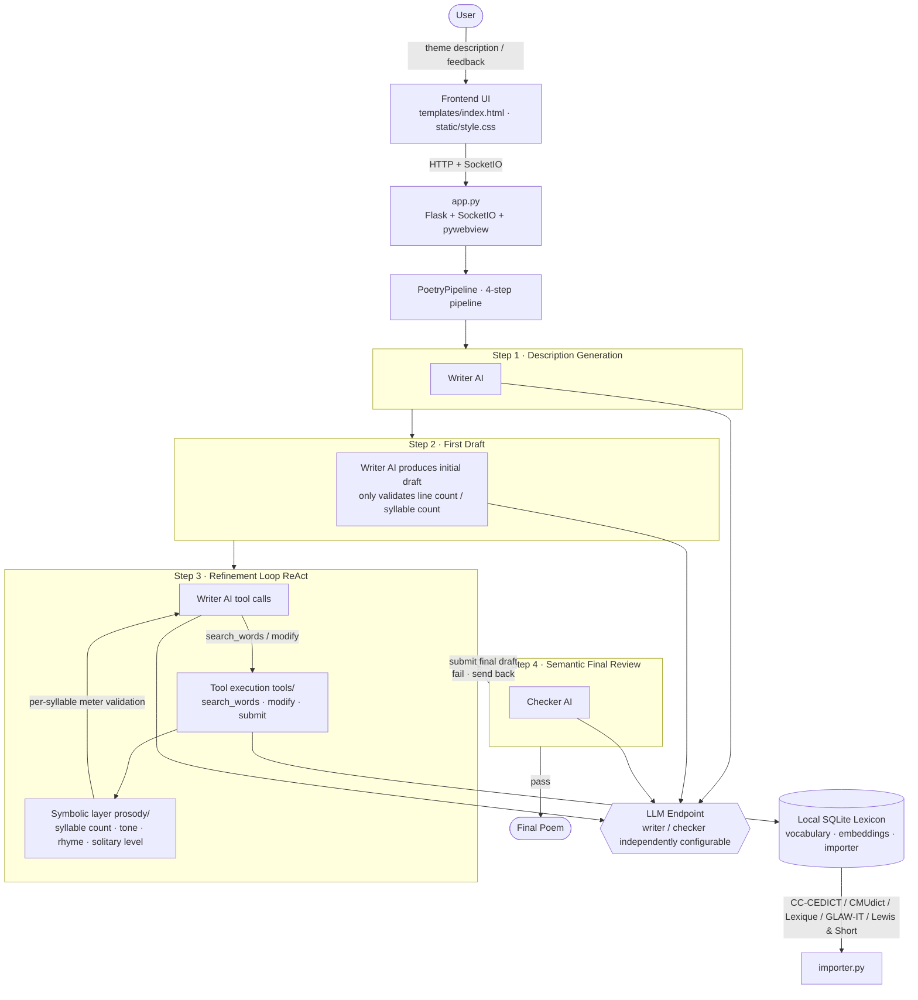
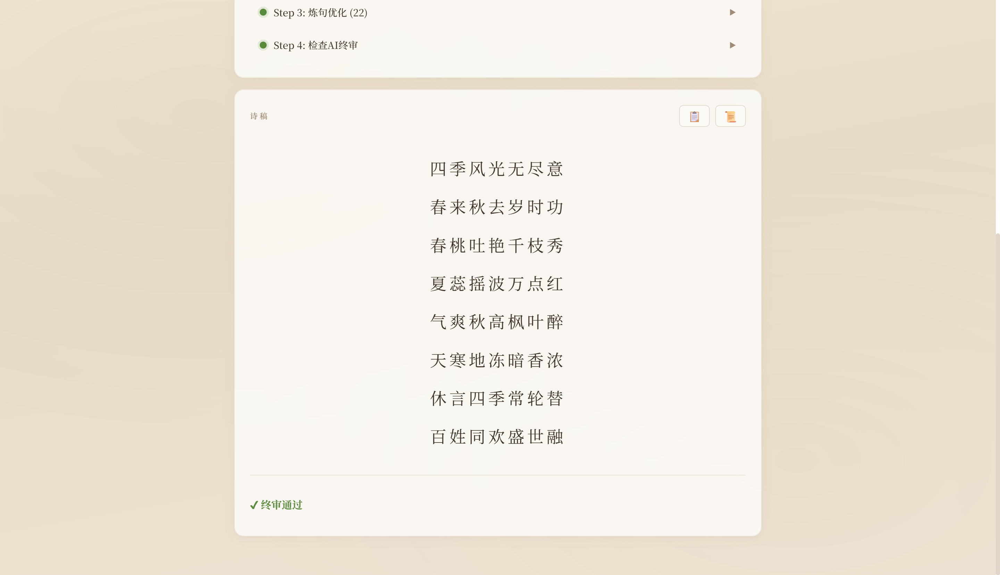

<!-- Copyright (c) 2026 xhdlphzr -->
<!-- SPDX-License-Identifier: MIT -->

# StanzaWeaver

> **Weaving Stanzas with Wisdom** — A Neuro-Symbolic Intelligent Poetry Generation Desktop Application

[](https://github.com/xhdlphzr/StanzaWeaver/stargazers)
[](https://github.com/xhdlphzr/StanzaWeaver/issues)
[](https://github.com/xhdlphzr/StanzaWeaver/pulls)
[](https://github.com/xhdlphzr/StanzaWeaver/blob/master/LICENSE)
[](https://github.com/xhdlphzr/StanzaWeaver)
[](https://github.com/xhdlphzr/StanzaWeaver)
[](https://github.com/xhdlphzr/StanzaWeaver)

[](https://github.com/xhdlphzr/StanzaWeaver)
[](https://github.com/xhdlphzr/StanzaWeaver/blob/master/README.md)
[](https://github.com/xhdlphzr/StanzaWeaver/blob/master/docs/README.zh.md)

StanzaWeaver weaves together the "imagination of AI" and the "hard rules of meter": a modern large language model handles wording, phrasing, and artistic conception, while a zero‑AI‑overhead symbolic engine pins every line to the grid of tone, rhyme, and syllable count. The two are decoupled via structured tool calls—neither letting the model break the rules, nor freezing creativity into a fill‑in‑the‑blanks exercise.

---

## Table of Contents

- [Project Introduction](#project-introduction)
- [System Architecture](#system-architecture)
- [Core Features](#core-features)
- [Use Cases](#use-cases)
- [Demo](#demo)
- [Four‑Step Generation Pipeline](#fourstep-generation-pipeline)
- [Docker Deployment](#docker-deployment)
- [Project Structure](#project-structure)
- [Meter Templates](#meter-templates)
- [LLM Configuration](#llm-configuration)
- [License](#license)

---

## Project Introduction

### Design Philosophy: Neuro‑Symbolic

Poetry is the art of "dancing in chains". Pure neural network generation often produces beautiful words but loses tone and rhyme; pure rule‑based systems can be perfectly correct but utterly lifeless. StanzaWeaver adopts a **Neuro‑Symbolic** architecture, giving each layer its own role:

| Layer                     | Role           | Implementation              | Characteristics                                                        |
| :------------------------ | :------------- | :-------------------------- | :--------------------------------------------------------------------- |
| **Symbolic** (Hard Rules) | Meter Judge    | Pure Python validation code | Zero AI cost, deterministic, explainable                               |
| **Neural** (AI Semantics) | Poetic Creator | LLM + Tool Calling          | Handles description, artistic conception, refinement, and final review |

The symbolic layer handles: syllable counting, tone/stress/length constraints, rhyme checking, “three‑level‑tail”, “solitary level”, and “alternating tones at even positions” — all done in pure Python with zero LLM calls. The neural layer takes a modern‑language description, generates a poetic theme, conceives meaning, repeatedly refines under constraints, and finally reviews the finished piece for semantic coherence — all via a large language model (compatible with any OpenAI‑style endpoint) and tool calls.

### Why Tool‑Call Decoupling?

The two layers communicate **only through structured tools**. The AI can never output a block of free‑form text to "pretend" it has finished; it can only call these three tools with structured data:

- `search_words` – retrieve candidate words/phrases from the local lexicon by meaning, tone, or rhyme category
- `modify` – modify the poem by type: `line` (replace one line, then immediately run full meter validation), `title` (rename the title), or `punctuation` (set the punctuation list)
- `submit` – submit the final draft; may replace the whole poem (`poem`) and set punctuation (`punctuation`), and is accepted only after full‑poem meter validation passes

This "tools‑as‑interface" design keeps the AI’s creativity firmly within the boundaries of meter, and every modification is instantly verified by the symbolic layer — neither generating illegal lines, nor allowing the AI to bluff its way through with prose.

### Three‑Element Feedback Loop

The Writer AI, Checker AI, and the user form a triangular feedback loop: **if any link fails, the process is sent back to Step 3 for further refinement** — until the Checker AI passes it or the user is satisfied. There is no upper limit on refinement rounds; the model can keep polishing until it passes.

---

## System Architecture



---

## Core Features

- **Neuro‑Symbolic Dual Engine** – Hard meter rules are enforced by deterministic pure‑Python validation; the AI is responsible only for poetic meaning, decoupled via structured tools.
- **Four‑Step Generation Pipeline** – Description generation → First draft (syllable count only) → ReAct refinement loop (search + modify line/title/punctuation, or whole‑poem replacement via `submit`, with immediate full‑poem validation after each change) → Checker AI semantic final review.
- **Poem Sequence (组诗)** – The user picks the poem count and meter(s) (one meter for all, or a meter per poem); an Architect AI then writes the sequence title and a self‑contained prompt per poem, each poem is generated in its own session (with earlier poems injected for coherence) and reviewed per poem before assembly.
- **Three‑Element Feedback Loop** – Writer AI → Checker AI → User; any failure sends the work back to Step 3 for further refinement, **with no upper limit on refinement rounds**.
- **Multi‑language Meter** – Chinese (5‑character quatrain, 7‑character quatrain, 5‑character regulated verse, 7‑character regulated verse, Xiangjianhuan, Rumengling, Langtaosha, Qingpingyue), English (Shakespearean sonnet, villanelle, heroic couplet), Italian, French, Classical Latin; templates are defined as Python classes and can be extended indefinitely.
- **Multi‑Layer Meter Validation** – Per‑syllable tone/stress constraints + three‑level‑tail + solitary level + alternating tone rule + rhyme checking (Chinese grouped by Thirteen Rhymes, Western languages by real‑time phoneme‑based rhyme).
- **Custom Meter Templates + AI Template Editor** – The “+ Custom” dialog builds a template from the UI: per‑syllable constraints (labels shown in the UI language), up to 8 constraint variants joined by OR (e.g. the four tonal patterns of a quatrain), rhyme schemes such as `ABAB CDCD EFEF GG` with an optional “all rhyme groups must differ”, a free‑form rule description, and optional custom Python validation. A separately configurable **Template AI** can fill the same fields through tools, streaming its thinking, answers and every tool call (with arguments) into the dialog.
- **Cross‑Language Template Conversion** – A unified conversion interface (`POST /api/templates/convert`, shared by the UI and the Template AI) carries the line/syllable structure, constraint variants, rhyme scheme, custom validation code, rule description and data‑ised structural rules (e.g. the tone skeleton, “three‑level‑tail” and “solitary level” of regulated verse) into another language, mapping **only** the per‑syllable constraint values (many‑to‑one allowed). The UI reports exactly which parts are carried and which language‑specific rules are not.
- **Prompt‑Ready Rule Description** – Every custom template stores a free‑form rule description which is injected into the Writer AI prompt together with the symbolic constraints, so requirements that cannot be expressed numerically (diction, parallelism, imagery structure, translation constraints) still guide generation.
- **Template Library Management** – The “Manage” button opens a template list where rows can be dragged up/down to set the display order (persisted in `~/.stanza_weaver/template_order.json` and applied to every template dropdown) and custom templates can be deleted (their source file is removed too).
- **Real‑time Streaming Output** – LLM generation tokens are pushed to the frontend token by token, with the Step detail area continuously updating.
- **Separable Dual AI Agents** – Writer AI (3 tools) and Checker AI (1 tool) can use different LLM endpoints and models independently.
- **Local Lexicon + Vector Reranking** – SQLite lexicon (CC‑CEDICT / CMUdict / Lexique / GLAW‑IT / Lewis & Short), with `sentence‑transformers` for semantic reranking.
- **Desktop Packaging** – pywebview + Flask + SocketIO, packaged as a single executable using PyInstaller.


---

## Use Cases

The symbolic constraint engine is not limited to writing poems from scratch — it is also a practical tool for **constrained translation** and other meter‑aware tasks.

### 1. Poem Creation

- **From scratch** – enter a topic, pick a built-in or custom meter; the four-step pipeline drafts, refines against the symbolic rules and gets a semantic review.
- **Poem sequences** – plan multi-poem suites with the Architect AI (one meter for all, or a meter per poem).
- **Custom forms** – describe a form with per-syllable constraints, OR‑joined constraint variants, a rhyme scheme, custom Python rules and a free‑form rule description.
- **AI-authored templates** – describe the form in natural language and let the Template AI call tools to configure it (thinking, answers, tool names and arguments are all shown).
- **Cross-language adaptation** – convert a template into another language and keep its rhyme scheme and structural rules; the conversion report tells you what was carried and what was dropped.

### 2. Verse Translation

The same neuro-symbolic loop works for translating poetry (or any text) into a metrically constrained target form:

1. **Paste the source text into the topic box** and state the task, e.g. “Translate the following Tang poem into English heroic couplets, keep the imagery, do not add explanations.”
2. **Choose a target-language template** (e.g. Shakespearean sonnet for English, elegiac couplet for Latin), or **convert a source-language template** in the conversion panel to obtain the same line/syllable structure and rhyme scheme in the target language.
3. **Write the translation requirements into the template’s rule description** (literal vs. literary, register, images/names that must be preserved, rhyme constraints) — it is sent to the Writer AI as part of the meter prompt and can be edited per task.
4. **Let the four-step loop work** – the Writer AI proposes lines, the symbolic layer rejects any line that breaks syllable/tone/rhyme rules, and the Checker AI reviews semantic fidelity and rejects meaning drift so the draft is refined again.
5. **Iterate from the poem panel** – press “Reject” and give feedback such as “more literal”, “keep the river image”, “avoid archaic words”.

Why it works: constraints are symbolic, so each candidate line is validated deterministically instead of being trusted from the model’s own claims; and because the Writer AI can only act through tools, it cannot silently abandon the rhyme scheme. When a source form relies on rules that cannot be transported (refrains, caesura, stress‑position rules, …), the conversion report names them so you can re-express them in the rule description or custom validation code.

### 3. Other Scenarios

- **Constrained / experimental writing** – fixed rhyme schemes, lipograms, pattern poetry, punning under meter.
- **Teaching and practice** – inspect the symbolic errors to explain why a line breaks the meter rules; build textbook exercise templates.
- **Bilingual adaptation** – translate a poem, then re-constrain it with a target‑language template for publication or performance.

---

## Demo

The following image shows the generation interface and refinement process:



---

## Four‑Step Generation Pipeline

1. **Step 1 · Description Generation** – The Writer AI takes the user’s modern‑language theme and produces a poetic description (a “creative outline” reused in later steps).
2. **Step 2 · First Draft** – The Writer AI produces an initial draft respecting the template’s meter requirements (line count, syllable count). Only line and syllable counts are validated at this stage.
3. **Step 3 · Refinement Loop (ReAct)** – The AI repeatedly calls `search_words` to find compliant words/phrases and `modify` to change a line, the title, or the punctuation; it may also call `submit` with a whole new poem (`poem`) or a punctuation list. Every modification immediately triggers symbolic‑layer full‑poem validation. The AI may call `submit` at any time, but the submission is accepted **only after the full‑poem meter validation passes** — otherwise it is rejected with the concrete errors and the loop continues. **There is no upper limit on this loop**; it continues until the draft is submitted with a valid meter.
4. **Step 4 · Semantic Final Review** – The Checker AI receives the user's original prompt sent to the Writer AI plus the template rule description (and the latest user feedback), **not** the AI‑refined theme description, so its pass/fail decision is based on the user's actual requirements rather than on the Writer AI's own summary. It checks conformity with those requirements as well as coherence and higher‑level dimensions beyond meter. It then calls `submit` to give a pass/fail decision; if it fails, suggestions are sent back to Step 3 for further refinement, and the poem is finalised only after it passes.

---

## Poem Sequence (组诗)

A poem sequence is generated in three phases, mirroring the multi‑movement architecture:

1. **Sequence Planning** – The user fixes the poem count and meter(s) (one meter for all, or a meter per poem). The Architect AI then only uses `set_sequence_title` and `set_poem_prompt` (no `add_poem`): the poems are pre‑seeded from the chosen meters, and the planner writes a self‑contained prompt for each. Missing prompts are fed back and planning continues (bounded by `max_rounds`). Prompts must not use cross‑poem references such as “see poem N”.
2. **Per‑Poem Composition** – Poems are composed in order, each in an independent session that reuses the single‑poem pipeline (description → draft → refine → checker review). The sequence goal and the titles/first lines of earlier poems are injected; symbolic meter validation and the Checker AI run **per poem**.
3. **Assembly** – Finished poems are assembled under the sequence title. Cross‑poem coherence relies on planning + injection rather than a whole‑sequence symbolic check.

---

## Docker Deployment

Run as a web service (no local Python environment required):

Use the one‑click scripts in `scripts/` (Windows and Linux/macOS, all support `-h` for help):

| Platform   | Build                                               | Run                                                   |
| :--------- | :-------------------------------------------------- | :---------------------------------------------------- |
| PowerShell | `.\scripts\build.ps1 [-t tag] [-b base-image] [-n]` | `.\scripts\run.ps1 [-p port] [-d] [-l] [--no-volume]` |
| cmd        | `scripts\build.bat [-t tag] [-b base-image] [-n]`   | `scripts\run.bat [-p port] [-d] [-l] [--no-volume]`   |
| bash       | `./scripts/build.sh [-t tag] [-b base-image] [-n]`  | `./scripts/run.sh [-p port] [-d] [-l] [--no-volume]`  |

Example: `.\scripts\build.ps1 -b docker.m.daocloud.io/library/python:3.14-slim` to build, and `.\scripts\run.ps1 -d -l` to run in background and follow logs.

Notes:

- **Dependencies** – Uses the full project dependencies declared in `pyproject.toml` and locked by `uv.lock` (managed with [uv](https://docs.astral.sh/uv/); includes desktop GUI and embedded reranking components, same functionality as local). The Linux image includes all these dependencies, so the image is large and initial build is slow, but can be reused after the first build.
- **Data Persistence** – Configuration, lexicon, history, and logs are persisted via the `stanzaweaver-data` volume, mounted to `~/.stanza_weaver` inside the container.
- **Security** – The application only accepts `localhost`/`127.0.0.1` Host headers (via `app.py`’s `_guard_local_access`). Docker deployment must access via `http://localhost:5000`; on Linux you can also use `network_mode: host` (see comments in `docker-compose.yml`).
- **Custom Templates** – The image sets `STANZAWEAVER_TEMPLATES_DIR=/home/stanzaweaver/.stanza_weaver/templates`, so templates created via the UI (including constraint tables, rhyme scheme, rule description and custom code) are stored in the `stanzaweaver-data` volume and persist across container rebuilds; without the volume they are lost with the container.
- **Logs** – Container log files are located at `~/.stanza_weaver/logs/stanza.log` (persisted via the volume); you can override with `STANZAWEAVER_LOG_DIR`. `docker compose logs` shows standard output.

---

## Project Structure

```
StanzaWeaver/
├── .dockerignore
├── .gitignore
├── .python-version         # Python version (uv)
├── Dockerfile              # Image build (Python 3.14-slim + desktop/reranking dependencies)
├── LICENSE                 # MIT License
├── README.md               # Project documentation
├── Franx.ico               # Application icon
├── StanzaWeaver.spec       # PyInstaller build spec
├── app.py                  # pywebview + Flask + SocketIO entry point
├── docker-compose.yml      # Compose deployment
├── pyproject.toml          # Project dependencies (uv) + tool config
├── uv.lock                 # Locked dependency versions (uv)
├── assets/
│   └── 1.png               # Demo screenshot
├── scripts/                # Cross‑platform one‑click build/run scripts
│   ├── build.bat
│   ├── build.ps1
│   ├── build.sh
│   ├── run.bat
│   ├── run.ps1
│   └── run.sh
├── static/
│   └── style.css           # Frontend styles
├── templates/
│   └── index.html          # Frontend UI
└── src/
    ├── __init__.py
    ├── config.py            # LLM multi‑endpoint configuration
    ├── logging_setup.py     # Logging initialisation (RotatingFileHandler rotation)
    ├── models/              # Data models
    │   ├── __init__.py
    │   ├── syllable.py      # Syllable
    │   └── word.py          # Word entry
    ├── prosody/             # Symbolic layer: meter utilities
    │   ├── __init__.py
    │   ├── base.py          # SyllableAnalyzer abstract base class
    │   ├── chinese.py       # Chinese analyser (pypinyin)
    │   ├── english.py       # English analyser (CMUdict)
    │   ├── french.py        # French analyser
    │   ├── italian.py       # Italian analyser
    │   ├── latin.py         # Latin analyser
    │   ├── meter_validator.py   # Master meter validator
    │   └── syllable_counter.py  # Unified multi‑language syllable counting
    ├── knowledge/           # Local lexicon
    │   ├── __init__.py
    │   ├── embeddings.py    # sentence‑transformers vector reranking
    │   ├── importer.py      # Dataset import (CC‑CEDICT / CMUdict / Lexique / GLAW‑IT / Lewis & Short)
    │   ├── schema.sql       # SQLite schema
    │   └── vocabulary.py    # Query interface
    ├── agents/              # Neural layer: AI Agents
    │   ├── __init__.py
    │   ├── architect_ai.py  # Sequence Architect AI (planning tools)
    │   ├── base.py          # LLM call wrapper
    │   ├── checker_ai.py    # Checker AI (1 tool)
    │   ├── editor_ai.py     # Template AI (configures custom templates via tools)
    │   └── writer_ai.py     # Writer AI (3 tools)
    ├── tools/               # Agent tool definitions
    │   ├── __init__.py      # OpenAI Tool JSON Schemas
    │   ├── modify.py        # Modify execution (line/title/punctuation)
    │   ├── planning.py      # Architect planning tools
    │   ├── search_words.py  # Word search execution
    │   └── template_tools.py   # Template AI tools (syllables/constraints/rhyme/code/submit)
    ├── templates/           # Meter templates (Python classes)
    │   ├── __init__.py      # PoetryTemplate base class + registry
    │   ├── convert.py       # Unified cross‑language template conversion
    │   ├── rhyme.py         # Generic rhyme‑scheme checking
    │   ├── structural.py    # Data‑ised structural rules (regulated verse)
    │   ├── en.py            # English templates (sonnet, villanelle, heroic couplet)
    │   ├── fr.py            # French templates (rondeau, triolet, ballade)
    │   ├── it.py            # Italian templates (terza rima, ottava rima, canzone)
    │   ├── la.py            # Latin templates (hexameter, elegiac couplet, hendecasyllabic)
    │   └── zh.py            # Chinese templates (5‑char quatrain, 7‑char quatrain, etc.)
    └── pipeline/
        ├── __init__.py
        ├── pipeline.py      # 4‑step pipeline + feedback loop
        └── sequence.py      # Poem‑sequence pipeline
```

---

## Meter Templates

Templates are defined as Python classes inheriting from `PoetryTemplate`, and must implement:

| Method                       | Description                                                                          |
| :--------------------------- | :----------------------------------------------------------------------------------- |
| `get_syllable_constraints()` | Per‑position syllable constraints (used by `modify` for single‑line validation)    |
| `validate_full()`            | Full‑poem rule checking (three‑level‑tail, solitary level, rhyme, etc.)              |
| `describe()`                 | Human‑readable meter description (used in the AI prompt); it also contains the template's rule description |

Built‑in templates: 5‑character quatrain, 7‑character quatrain, 5‑character regulated verse, 7‑character regulated verse, Xiangjianhuan, Rumengling, Langtaosha, Qingpingyue, Shakespearean sonnet, villanelle, heroic couplet, Italian terza rima / ottava rima / canzone, French rondeau / triolet / ballade, Latin hexameter / elegiac couplet / hendecasyllabic.

To extend: add a new Python file under `src/templates/`, define the class, and register it in `app.py`; or use the UI’s “+ Custom” button to generate a template (automatically saved to `src/templates/custom_*.py` and restored on restart).

### Custom Template Editor

The “+ Custom” dialog builds a complete template without writing Python by hand:

| Capability | Details |
| :--- | :--- |
| Localized constraints | Per‑syllable constraints; attribute names and value labels follow the UI language (e.g. 轻/重 for stress, 长/短 for length) instead of always showing raw English. |
| Constraint variants (OR) | 1–8 constraint tables; the generation AI may satisfy **any one** of them — ideal for the four tonal patterns (仄起/平起 × 首句入韵/不入韵) of a quatrain. |
| Rhyme scheme | Per‑line rhyme groups A–J and complex schemes like `ABAB CDCD EFEF GG`; an optional “all rhyme groups must differ” switch (e.g. for sonnets). |
| Conversion from another template | Pick a source template, choose the target language, then map each source attribute value to a target value (many‑to‑one is allowed, one‑to‑many is impossible). |
| Rule description | A free‑form text stored with the template and injected into the Writer AI prompt together with the symbolic constraints — use it for diction, parallelism, imagery structure, translation requirements, etc. It is reused by conversion and can be edited afterwards. |
| Custom validation code | Optional Python appended to `validate_full` for whole‑form rules. |
| AI template editor | A third configurable LLM endpoint (“Template AI”). It edits exactly the same fields through tools and streams its thinking, answers and every tool call (name + arguments + result) into the dialog. |
| Template order & deletion | A “Manage” dialog lists all templates: drag rows to reorder (saved to `~/.stanza_weaver/template_order.json` and respected by every template dropdown), and delete custom templates (the generated source file is removed; built-in templates cannot be deleted). |
| Where templates are stored | Running from source: `src/templates/custom_*.py`. Packaged (PyInstaller) builds: `~/.stanza_weaver/templates/custom_*.py`, so templates are writable and survive app upgrades; templates created by older builds under `_internal/src/templates` are migrated automatically. Override the directory with `STANZAWEAVER_TEMPLATES_DIR`. |

### Cross‑Language Template Conversion

Conversion is implemented once in the backend and shared by the UI and the Template AI (`POST /api/templates/convert` / the `set_from_template` tool):
`convert_template()` in `src/templates/convert.py`.

- **Carried over**: line count, syllables per line, number of constraint variants, the constraint tables (values mapped), rhyme scheme + “distinct” flag, custom validation code, rule description, and **data‑ised structural rules** of regulated verse (tone skeleton, 三平尾 / “three‑level‑tail”, 孤平 / “solitary level”, rhyme‑tone requirement).
- **Only changed**: the per‑syllable constraint values, via the user’s mapping (e.g. `平 → heavy`, `仄 → light`; or `heavy → long` when converting further).
- **Reported in the UI**: “carried over” and “language‑specific special rules NOT carried over” lists. Rules that live only in code (refrains, caesura, tenth‑syllable stress, rhyme‑change rules, …) are declared as `special_rules` on each built‑in template and shown here, so nothing is silently lost.
- **Optional AI code rewriting**: tick “Rewrite the source template code with AI” in the conversion panel to send the source template's code plus the attribute mapping (e.g. 平 → light/heavy) to the Template AI, which rewrites the validation code for the target language. The result is placed in the custom-code editor and can be reviewed/edited before saving; this requires the Template AI (`editor`) endpoint.
- If the mapping is incomplete, the target language has no equivalent attribute, or both tone values collapse onto the same target value, the structural rules are **dropped with a reason** instead of producing a wrong rule.

---

## LLM Configuration

Supports any OpenAI‑compatible endpoint (OpenAI / Ollama / vLLM / DeepSeek / Groq, etc.):

```json
{
  "writer": {
    "base_url": "https://api.openai.com/v1",
    "api_key": "sk-xxx",
    "model": "gpt-4o"
  },
  "checker": {
    "base_url": "http://localhost:11434/v1",
    "api_key": "ollama",
    "model": "qwen2.5:7b"
  },
  "editor": {
    "base_url": "https://api.openai.com/v1",
    "api_key": "sk-xxx",
    "model": "gpt-4o"
  }
}
```

Three endpoints can be configured independently: `writer` (composition), `checker` (semantic review) and `editor` (Template AI that configures custom templates). The Template AI is optional — without an `editor` key the rest of the app works normally.

Edit directly in the UI via the gear icon, or manually edit `~/.stanza_weaver/config.json`.

### Ollama Local Deployment

```json
{
  "writer": {
    "base_url": "http://127.0.0.1:11434/v1",
    "api_key": "ollama",
    "model": "your_local_model_name"
  },
  "checker": {
    "base_url": "http://127.0.0.1:11434/v1",
    "api_key": "ollama",
    "model": "your_local_model_name"
  }
}
```

Notes:

- **Base URL must end with `/v1`** (Ollama’s OpenAI‑compatible endpoint), otherwise returns 404.
- The model name must be one installed (visible via `ollama list`); `:cloud` cloud models require an Ollama subscription, otherwise returns 403.
- **502 Bad Gateway** – Usually caused by `HTTP_PROXY`/`HTTPS_PROXY` environment variables set in the shell (e.g., Clash). StanzaWeaver automatically bypasses the proxy for `127.0.0.1`/`localhost`; if you still see 502, check your terminal environment variables.

---

## License

All code is open‑source under the [**MIT License**](LICENSE), Copyright (c) 2026 xhdlphzr.

All files under `assets/` are under the [**CC BY-NC-ND 4.0 License**](assets/LICENSE), Copyright (c) 2026 xhdlphzr.
