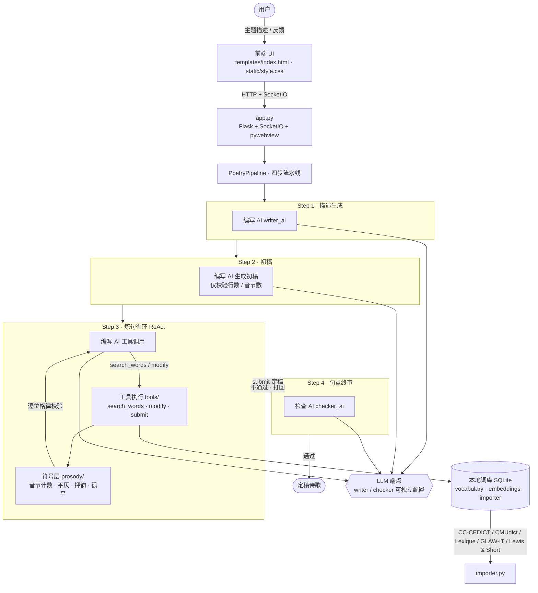

<!-- Copyright (c) 2026 xhdlphzr -->
<!-- SPDX-License-Identifier: MIT -->

# StanzaWeaver

> **以智识，巧织诗** —— 神经符号智能诗歌生成桌面软件

[](https://github.com/xhdlphzr/StanzaWeaver/stargazers)
[](https://github.com/xhdlphzr/StanzaWeaver/issues)
[](https://github.com/xhdlphzr/StanzaWeaver/pulls)
[](https://github.com/xhdlphzr/StanzaWeaver/blob/master/LICENSE)
[](https://github.com/xhdlphzr/StanzaWeaver)
[](https://github.com/xhdlphzr/StanzaWeaver)
[](https://github.com/xhdlphzr/StanzaWeaver)

[](https://github.com/xhdlphzr/StanzaWeaver)
[](https://github.com/xhdlphzr/StanzaWeaver/blob/master/README.md)
[](https://github.com/xhdlphzr/StanzaWeaver/blob/master/docs/README.zh.md)

StanzaWeaver 把「AI 的想象力」与「格律的硬规则」编织在一起：现代大模型负责遣词造句与意境构思，一套零 AI 开销的符号引擎负责把每一行诗钉死在平仄、押韵与字数的格子上。两者通过结构化的工具调用解耦，既不让模型天马行空地打破格律，也不让规则僵化成填空题。

---

## 目录

- [项目简介（项目书）](#项目简介项目书)
- [系统架构](#系统架构)
- [核心特性](#核心特性)
- [使用场景](#使用场景)
- [功能演示](#功能演示)
- [四步生成流水线](#四步生成流水线)
- [Docker 部署](#docker-部署)
- [项目结构](#项目结构)
- [格律模板](#格律模板)
- [LLM 配置](#llm-配置)
- [许可证](#许可证)

---

## 项目简介（项目书）

### 设计理念：神经符号（Neuro-Symbolic）

诗歌是「戴着镣铐跳舞」的艺术。纯神经网络生成常常文采斐然却平仄尽失、韵脚错乱；纯规则系统又能对却毫无灵气。StanzaWeaver 采用**神经符号**架构，让两层各司其职：

| 层                    | 角色       | 实现               | 特点                       |
| --------------------- | ---------- | ------------------ | -------------------------- |
| **符号层**（硬规则）  | 格律裁判   | 纯 Python 校验代码 | 零 AI 开销、确定、可解释   |
| **神经层**（AI 语义） | 诗意创作者 | LLM + Tool Calling | 负责描述、意境、炼句、终审 |

符号层负责：音节计数、平仄/轻重/长短约束、押韵检测、三平尾、孤平、二四六分明等，全部由 Python 代码完成，不消耗任何一次模型调用。神经层负责：从现代文描述生成诗歌主题、构思句意、在约束下反复炼句、以及对成稿做句意终审，通过大语言模型（兼容 OpenAI API 的任意端点）与工具调用实现。

### 为何用工具调用解耦

两层之间**只通过结构化工具通信**，AI 永远不能输出一大段自由文本来「假装」交稿，只能调用以下三个工具给出结构化数据：

- `search_words`：按释义/平仄/韵部检索本地词库，给 AI 提供合规的字词候选；
- `modify`：按类型修改诗稿——`line` 整行替换（改完立即跑一遍全部格律约束）、`title` 改标题、`punctuation` 改标点列表；
- `submit`：提交定稿，可用 `poem` 整首替换、用 `punctuation` 设置标点（全诗格律校验通过后才被接受）。

这种「工具即接口」的设计，使 AI 的创造力被牢牢框在格律的边界内，也让每一次修改都可被符号层即时验证——既不会生成不合规的诗句，也不会让 AI 用散文糊弄过去。

### 三要素反馈闭环

编写 AI、检查 AI、用户构成三角反馈：**任意一环不通过，都打回 Step 3 继续炼句**，直到检查 AI 终审通过或用户满意定稿。炼句轮数不设上限，模型可一直精修到通过为止。

---

## 系统架构



---

## 核心特性

- **神经符号双引擎**：硬格律规则由纯 Python 确定性校验，AI 只负责诗意，二者经结构化工具解耦。
- **四步生成流水线**：描述生成 → 初稿（仅验音节数）→ ReAct 炼句循环（搜词 + modify 改行/标题/标点，或用 submit 整首替换，每次改动即时全量格律校验）→ 检查 AI 句意终审。
- **诗组（组诗）**：用户先指定诗的数量与格律（可全部统一，也可逐首指定）；架构师 AI 只负责诗组总标题与每首自足的创作要求，随后每首诗在独立会话中生成（注入前作以保证呼应），逐首做符号层校验与检查 AI 终审，最后汇总成诗组。
- **三要素反馈闭环**：编写 AI → 检查 AI → 用户，任一环不通过即打回 Step 3 续炼，**炼句轮数无上限**。
- **多语言格律**：中文（五绝 / 七绝 / 五律 / 七律 / 相见欢 / 如梦令 / 浪淘沙 / 清平乐）、英文（商籁体 / 维拉内拉 / 英雄双行体）、意大利语、法语、古典拉丁语；模板以 Python 类定义，可无限扩展。
- **多层格律校验**：逐位平仄/轻重约束 + 三平尾 + 孤平 + 二四六分明 + 押韵检测（中文按十三辙归并，西语按实时音素韵脚）。
- **自定义模板 + 模板 AI**：自定义弹窗里可配置逐位约束（属性名/值标签跟随界面语言显示）、最多 8 种「或」关系的约束表（如绝句的仄起/平起等四种平仄格式）、复杂韵式（如 `ABAB CDCD EFEF GG`，可要求不同韵组互异）、自由规则描述与自定义 Python 校验代码；另有独立可配置的**模板 AI**，通过工具配置同一套字段，并实时显示思考、回答与每次工具调用（名称 + 参数 + 结果）。
- **跨语言模板转化**：统一接口（`POST /api/templates/convert`，界面与模板 AI 的 `set_from_template` 共用）把行数、每行音节、约束种类、韵式、自定义代码、规则描述以及**数据化的结构规则**（近体诗平仄骨架、三平尾、孤平、韵脚声调）带到目标语言，**只映射逐位约束的属性值**（允许多对一、不合法一对多）；界面明确列出「已携带」与「不会携带的语言专属特殊规则」。
- **规则描述即 prompt**：每个自定义模板可填写一段自由文本规则描述，生成诗歌时与符号约束一起注入写作 AI 的 prompt，用来表达无法数值化的要求（用词、对仗、意象结构、翻译要求等）。
- **实时流式输出**：LLM 生成过程逐 token 推送到前端，Step 详情区持续展开更新。
- **双 AI 代理可分离**：编写 AI（3 工具）与检查 AI（1 工具）可各自配置不同 LLM 端点与模型。
- **本地词库 + 向量重排**：SQLite 词库（CC-CEDICT / CMUdict / Lexique / GLAW-IT / Lewis & Short），`sentence-transformers` 做语义重排。
- **桌面打包分发**：pywebview + Flask + SocketIO，pyinstaller 打包为单文件 exe。


---

## 使用场景

符号层并不只为「从零写诗」服务——它同样适合**约束翻译**等需要格律意识的场景。

### 1. 诗歌创作

- **从主题开始**：输入主题、选择内置或自定义格律，四步流水线完成描述 → 初稿 → 炼句 → 终审。
- **诗组创作**：由架构师 AI 规划组诗标题与每首自足的创作要求，可全部统一格律或逐首指定。
- **自定义格律**：逐位约束、多种「或」约束、复杂韵式、自由规则描述与自定义校验代码组合出任意诗体。
- **AI 写模板**：用自然语言描述想要的模板，模板 AI 调用工具配置（思考、回答、工具名与参数全部可见），可直接提交生成模板。
- **跨语言改编**：把模板转化到另一种语言，保留韵式与结构规则；转化报告会说明哪些规则被携带、哪些未被携带。

### 2. 诗歌/韵文翻译

同一套神经符号循环也适合把诗歌（或任意文本）翻译成有格律的目标形式：

1. **把原文粘贴到「主题」框**并说明任务，例如「把下面这首唐诗译成英文英雄双行体，保留意象，不要加解释」。
2. **选择目标语言模板**（如英文商籁体、拉丁语哀歌双行体），或在转化面板中**把源语言模板转化成目标语言**，得到相同的行数/音节结构与韵式。
3. **在「模板规则描述」中写翻译要求**（直译/意译、语体、必须保留的意象与人名、押韵要求……）——它会作为写作 AI 的格律 prompt 的一部分，可针对每次任务修改。
4. **让四步流水线工作**：写作 AI 出句，符号层按音节/平仄/韵式即时否决不合规的行，检查 AI 复审语义是否偏离原文，偏离则打回重炼。
5. **在诗稿区反复迭代**：点「不定稿」并反馈「再贴近原文」「保留江月意象」「不要用古奥词」等意见。

之所以可行：约束是符号化的，每一行都由确定性规则校验，而不是听模型自称合规；写作 AI 只能通过工具改诗，无法悄悄放弃韵式。若源模板依赖无法搬运的规则（叠句、caesura、重音位置等），转化报告会明确列出，你可以用规则描述或自定义校验代码重新表达。

### 3. 其他场景

- **约束写作/实验写作**：固定韵式、字母禁用（lipogram）、图案诗、双关等。
- **教学与练习**：借助符号层报错解释某句为何不合律，或用自定义模板复刻教材练习。
- **双语改编**：先翻译，再用目标语言模板重新约束，用于发表或朗诵。

---

## 功能演示

下图展示 StanzaWeaver 的生成界面与炼句过程：


---

## 四步生成流水线

1. **Step 1 · 描述生成**：编写 AI 根据用户输入的现代文主题，提炼出诗歌的主题描述（供后续步骤复用的「创作大纲」）。
2. **Step 2 · 初稿**：编写 AI 依据模板的格律要求（行数、音节数）生成初稿，此阶段仅做行数与音节数校验。
3. **Step 3 · 炼句循环（ReAct）**：AI 反复调用 `search_words` 检索合规字词、`modify` 修改某行/标题/标点，也可调用 `submit` 以 `poem` 整首替换或 `punctuation` 设置标点；每一次修改都立即触发符号层对全诗的格律校验。AI 可随时调用 `submit`，但提交仅在**全诗格律校验通过后**才被接受——不通过则以具体错误打回并继续炼句。**该循环无轮数上限**，直到以合律诗稿提交定稿。
4. **Step 4 · 句意终审**：检查 AI 会收到用户发给创作 AI 的原始提示词、模板规则描述（以及用户最近的修改反馈），**不使用创作 AI 自己提炼的主题描述**，因此评审基准是用户的真实要求而不是模型的二次概括；除句意与格律之外的高级维度外，还会逐条核对成稿是否符合用户要求。随后调用 `submit` 给出「通过 / 打回」；不通过则携带建议打回 Step 3 继续炼句，通过则定稿。

---

## 诗组（组诗）

诗组按三阶段生成，模仿多乐章架构：

1. **诗组规划**：用户先固定诗的数量与格律（可全部统一，也可逐首指定）。架构师 AI 随后只使用 `set_sequence_title` 与 `set_poem_prompt`（不再用 `add_poem`）：诗单按所选格律预先铺好，架构师为每首写入自足的创作要求；缺失则回灌提醒继续补，超过 `max_rounds` 放弃。每首要求不得写「参见第 N 首」这类跨首指代。
2. **逐首生成**：按顺序为每首诗开启独立会话，复用单首流水线（描述 → 初稿 → 炼句 → 检查 AI 终审）；注入诗组总目标与前面已完成诗作的标题/首句，符号格律校验与检查 AI 均**按首**进行。
3. **汇总**：把各首诗按诗组标题汇成结果。跨首一致性靠规划与注入，而不是整组符号检查。

---

## Docker 部署

以 Web 服务方式运行（无需本地 Python 环境）：

用 `scripts/` 下的一键脚本（Windows 与 Linux/macOS 通用，均支持 `-h` 查看参数）：

| 平台       | 构建                                                | 运行                                                  |
| ---------- | --------------------------------------------------- | ----------------------------------------------------- |
| PowerShell | `.\scripts\build.ps1 [-t tag] [-b base-image] [-n]` | `.\scripts\run.ps1 [-p port] [-d] [-l] [--no-volume]` |
| cmd        | `scripts\build.bat [-t tag] [-b base-image] [-n]`   | `scripts\run.bat [-p port] [-d] [-l] [--no-volume]`   |
| bash       | `./scripts/build.sh [-t tag] [-b base-image] [-n]`  | `./scripts/run.sh [-p port] [-d] [-l] [--no-volume]`  |

示例：`.\scripts\build.ps1 -b docker.m.daocloud.io/library/python:3.14-slim` 构建，`.\scripts\run.ps1 -d -l` 后台运行并跟随日志。

说明：

- **依赖**：直接用项目完整依赖（由 [uv](https://docs.astral.sh/uv/) 依据 `pyproject.toml` 声明、`uv.lock` 锁定；含桌面 GUI 与嵌入重排组件，功能与本地一致）；Linux 镜像会同时包含这些依赖，镜像较大、首次构建较慢，但构建一次后可复用。
- **数据持久化**：配置、词库、历史记录、日志通过 volume `stanzaweaver-data` 持久化到容器内 `~/.stanza_weaver`。
- **安全设计**：应用仅接受 `localhost`/`127.0.0.1` 的 Host 头（`app.py` 的 `_guard_local_access`），Docker 部署需通过 `http://localhost:5000` 访问；Linux 下也可改用 `network_mode: host`（见 `docker-compose.yml` 注释）。
- **自定义模板**：镜像设置了 `STANZAWEAVER_TEMPLATES_DIR=/home/stanzaweaver/.stanza_weaver/templates`，通过 UI 创建的模板（含约束表、韵式、规则描述与自定义代码）会存到 `stanzaweaver-data` 卷中，容器重建后仍然保留；不挂载该卷则会随容器丢失。
- **日志**：容器内日志文件位于 `~/.stanza_weaver/logs/stanza.log`（随 volume 持久化），`STANZAWEAVER_LOG_DIR` 可重定向；`docker compose logs` 可看标准输出。

---

## 项目结构

```
StanzaWeaver/
├── .dockerignore
├── .gitignore
├── .python-version         # Python 版本（uv）
├── Dockerfile              # 镜像构建（Python 3.14-slim + 桌面/重排依赖）
├── LICENSE                 # MIT 许可证
├── README.md               # 项目文档
├── Franx.ico               # 应用图标
├── StanzaWeaver.spec       # PyInstaller 构建规格
├── app.py                  # pywebview + Flask + SocketIO 入口
├── docker-compose.yml      # Compose 部署编排
├── pyproject.toml          # 项目依赖（uv）+ 工具配置
├── uv.lock                 # 锁定的依赖版本（uv）
├── assets/
│   └── 1.png               # 功能演示截图
├── scripts/                # 跨平台一键构建/运行脚本
│   ├── build.bat
│   ├── build.ps1
│   ├── build.sh
│   ├── run.bat
│   ├── run.ps1
│   └── run.sh
├── static/
│   └── style.css           # 前端样式
├── templates/
│   └── index.html          # 前端 UI
└── src/
    ├── __init__.py
    ├── config.py            # LLM 多端点配置
    ├── logging_setup.py     # 日志初始化（RotatingFileHandler 轮转）
    ├── models/              # 数据模型
    │   ├── __init__.py
    │   ├── syllable.py      # 音节 Syllable
    │   └── word.py          # 词条 Word
    ├── prosody/             # 符号层：格律工具
    │   ├── __init__.py
    │   ├── base.py          # SyllableAnalyzer 抽象基类
    │   ├── chinese.py       # 中文分析器（pypinyin）
    │   ├── english.py       # 英文分析器（CMUdict）
    │   ├── french.py        # 法语分析器
    │   ├── italian.py       # 意大利语分析器
    │   ├── latin.py         # 拉丁语分析器
    │   ├── meter_validator.py   # 格律总校验
    │   └── syllable_counter.py  # 多语言统一音节计数
    ├── knowledge/           # 本地词库
    │   ├── __init__.py
    │   ├── embeddings.py    # sentence-transformers 向量重排
    │   ├── importer.py      # 数据集导入（CC-CEDICT / CMUdict / Lexique / GLAW-IT / Lewis & Short）
    │   ├── schema.sql       # SQLite 建表
    │   └── vocabulary.py    # 查询接口
    ├── agents/              # 神经层：AI Agent
    │   ├── __init__.py
    │   ├── architect_ai.py  # 诗组架构师 AI（规划工具）
    │   ├── base.py          # LLM 调用封装
    │   ├── checker_ai.py    # 检查 AI（1 工具）
    │   ├── editor_ai.py     # 模板 AI（通过工具配置自定义模板）
    │   └── writer_ai.py     # 编写 AI（3 工具）
    ├── tools/               # Agent 工具定义
    │   ├── __init__.py      # OpenAI Tool JSON Schema（search_words / modify / submit）
    │   ├── modify.py        # 修改执行（行/标题/标点）
    │   ├── planning.py      # 架构师规划工具
    │   ├── search_words.py  # 搜词执行
    │   └── template_tools.py   # 模板 AI 工具（音节/约束/韵式/代码/提交）
    ├── templates/           # 格律模板（Python 类）
    │   ├── __init__.py      # PoetryTemplate 基类 + 注册表
    │   ├── convert.py       # 统一的跨语言模板转化
    │   ├── rhyme.py         # 通用韵式校验
    │   ├── structural.py    # 数据化结构规则（近体诗）
    │   ├── en.py            # 英文模板（商籁体/维拉内拉/英雄双行体）
    │   ├── fr.py            # 法语模板（回旋诗/三韵叠句诗/叙事歌）
    │   ├── it.py            # 意大利语模板（三行体/八行体/歌谣）
    │   ├── la.py            # 拉丁语模板（六步格/哀歌双行体/十一音节诗）
    │   └── zh.py            # 中文模板（五绝/七绝/五律/七律/相见欢/如梦令/浪淘沙/清平乐）
    └── pipeline/
        ├── __init__.py
        ├── pipeline.py      # 4 步流水线 + 打回循环
        └── sequence.py      # 诗组流水线
```

---

## 格律模板

模板以 Python 类形式定义，继承 `PoetryTemplate`，需实现：

| 方法                         | 说明                                    |
| ---------------------------- | --------------------------------------- |
| `get_syllable_constraints()` | 逐位音节约束（供 modify 单行校验）      |
| `validate_full()`            | 完整规则检查（三平尾、孤平、押韵等）    |
| `describe()`                 | 人类可读的格律描述（供 AI prompt 使用，其中包含模板规则描述） |

内置模板：五言绝句、七言绝句、五言律诗、七言律诗、相见欢、如梦令、浪淘沙、清平乐、莎士比亚商籁体、维拉内拉诗、英雄双行体、意大利语三行体/八行体/歌谣、法语回旋诗/三韵叠句诗/叙事歌、拉丁语六步格/哀歌双行体/十一音节诗。

扩展方式：在 `src/templates/` 下新增 Python 文件，实现模板类后在 `app.py` 中注册；或在 UI 中通过「+ 自定义」生成模板（自动落盘到 `src/templates/custom_*.py`，重启后自动恢复注册）。

### 自定义模板编辑器

「+ 自定义」弹窗不写代码也能配置出完整模板：

| 能力 | 说明 |
| :--- | :--- |
| 约束值本地化 | 逐位音节约束；属性名与取值标签跟随界面语言显示（如 stress 显示为 轻/重、length 显示为 长/短），不再固定显示英文。 |
| 多重约束（或） | 1–8 张约束表，生成时满足**任意一张**即可——适合绝句的仄起/平起 × 首句入韵/不入韵四种平仄格式。 |
| 押韵韵式 | 逐行韵脚 A–J，支持 `ABAB CDCD EFEF GG` 这类复杂韵式；可选「不同韵组必须互不相同」（如商籁体）。 |
| 从其它模板转化 | 选择源模板与目标语言，把源语言的每个属性值映射为目标值（允许多对一，不允许一对多），一键应用。 |
| 规则描述 | 一段自由文本，随模板保存，生成时与符号约束一起注入写作 AI 的 prompt——用于表达用词、对仗、意象结构、翻译要求等无法数值化的规则；转化时会复用源模板的描述，之后仍可自行修改。 |
| 自定义校验代码 | 可选 Python 代码，追加到 `validate_full` 中做整体规则校验。 |
| 模板 AI | 第三个可独立配置的 LLM 端点；通过工具修改与界面上完全相同的字段，并实时显示其思考、回答与每次工具调用（名称 + 参数 + 结果）。 |
| 模板存放位置 | 源码运行：`src/templates/custom_*.py`；PyInstaller 编译版：`~/.stanza_weaver/templates/custom_*.py`，目录可写且升级不丢失；旧版编译版在安装目录 `_internal/src/templates` 下的模板会自动迁移。可用 `STANZAWEAVER_TEMPLATES_DIR` 覆盖目录。 |

### 跨语言模板转化

转化只实现一次、由界面与模板 AI 共用：`POST /api/templates/convert` 与 `set_from_template` 工具都调用 `src/templates/convert.py` 的 `convert_template()`。

- **携带**：行数、每行音节数、约束种类数、约束表（值按映射转换）、韵式与「不同韵组互异」、自定义校验代码、规则描述，以及**数据化的结构规则**（近体诗平仄骨架、三平尾、孤平、韵脚声调要求）。
- **只转换**：逐位约束的属性值（按用户映射，如 `平 → heavy`、`仄 → light`；再转下一个语言时可 `heavy → long`）。
- **界面明示**：转化面板会列出「将携带」与「不会携带的语言专属特殊规则」。只存在于代码里的规则（叠句、caesura、第 10 音节重读、换韵规则等）由各内置模板的 `special_rules` 声明并展示，不会被静默丢弃。
- 若映射不完整、目标语言没有对应属性、或平/仄被映到同一个值，结构规则会**带原因地丢弃**，而不是生成错误规则。

---

## LLM 配置

支持任何兼容 OpenAI API 格式的端点（OpenAI / Ollama / vLLM / DeepSeek / Groq 等）：

```json
{
  "writer": {
    "base_url": "https://api.openai.com/v1",
    "api_key": "sk-xxx",
    "model": "gpt-4o"
  },
  "checker": {
    "base_url": "http://localhost:11434/v1",
    "api_key": "ollama",
    "model": "qwen2.5:7b"
  },
  "editor": {
    "base_url": "https://api.openai.com/v1",
    "api_key": "sk-xxx",
    "model": "gpt-4o"
  }
}
```

三个端点可独立配置：`writer`（写诗）、`checker`（句意终审）、`editor`（配置自定义模板的模板 AI）。模板 AI 可选，不填 `editor` 时其余功能正常使用。

UI 齿轮按钮中直接编辑保存，或手动编辑 `~/.stanza_weaver/config.json`。

### Ollama 本地部署

```json
{
  "writer": {
    "base_url": "http://127.0.0.1:11434/v1",
    "api_key": "ollama",
    "model": "你的本地模型名"
  },
  "checker": {
    "base_url": "http://127.0.0.1:11434/v1",
    "api_key": "ollama",
    "model": "你的本地模型名"
  }
}
```

注意事项：

- **Base URL 必须带 `/v1`**（Ollama 的 OpenAI 兼容端点），否则返回 404。
- 模型名必须是 `ollama list` 中已安装的模型；`:cloud` 云模型需要 Ollama 订阅，否则返回 403。
- **502 Bad Gateway**：通常是 shell 中设置了 `HTTP_PROXY`/`HTTPS_PROXY` 环境变量（如 Clash 等代理工具），本地请求被转发给代理导致。StanzaWeaver 已对 `127.0.0.1`/`localhost` 自动绕过代理直连，若仍出现 502，请检查启动 app 的终端环境变量。

---

## 许可证

所有代码均使用 [**MIT许可证**](../LICENSE) 开源，Copyright (c) 2026 xhdlphzr。

`assets/` 目录内所有文件均使用 [**CC BY-NC-ND 4.0许可证**](../asstes/LICENSE)，Copyright (c) 2026 xhdlphzr。
